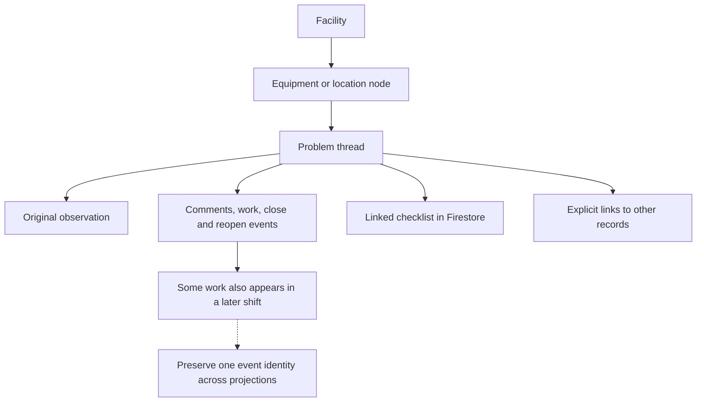

# What exactly are we organizing?

[Start here](README.md) · [Previous: experience](02-search-jobs-and-experience.md) · [Next: aliases](04-assets-aliases-and-languages.md)

**Proposal:** use the existing record thread as the first search container, but preserve identifiable events within it. A result can match a small piece of evidence while displaying the larger incident it belongs to.

**Book basis:** EPUB §§3–4, 12, 26–29, 32–33, 37–43, 59. **Local basis:** [domain model](/Users/maksimklimenko/dev/infl/ai-handoff/02-PRODUCT-AND-DOMAIN.md) and [data architecture](/Users/maksimklimenko/dev/infl/ai-handoff/04-DATA-MODEL.md). All field groups below are design proposals, not changes to the shared storage contracts.

## Distinguish four things people often call a record

| Thing | Meaning | Example, synthetic |
| --- | --- | --- |
| Source record | An authoritative stored entry | The original problem and its sub-records |
| Operational incident | The real-world occurrence being discussed | A motor trip during a shift; not guaranteed one-to-one with a source record |
| Search document | A derived representation built for retrieval | Selected fields, equipment names, nested events, aliases |
| Result card / answer | A presentation of retrieved evidence | A snippet and a link, or a dated summary |

A search document may describe an incident, but it cannot prove how many physical incidents occurred. Two source problems may concern one occurrence; one long thread may include several recurrences. Begin with **record-thread identity**, and avoid claiming automatic incident identity resolution.

## The useful structure already exists

The handoff describes top-level problems and work records; nested comments, work, state changes, and links; metadata changes in an audit log; Firestore checklists; and equipment nodes at three levels below a facility.

A key subtlety: an L3 node may be a machine **or a “General” area node**. It is a reliable location attachment, not proof that every component mentioned in the text has its own asset identity.



In words: an issue is a container for evidence; some evidence is also displayed elsewhere. Multiple appearances do not automatically mean multiple events.

## Use three retrieval levels, introduced incrementally

| Level | Good for | First implementation |
| --- | --- | --- |
| Parent thread / standalone work | Finding an issue or a short work record | One search document per top-level source record, with explicit links |
| Event / passage | Finding the exact test, comment, or correction | Preserve nested event identity and source fields; add separate passage documents only if measured need justifies them |
| Equipment context | “History of this machine” | Existing location keys and names; separate component identities only where verified |

Do not omit standalone work records because they have little or no `description`: the handoff says their useful text is primarily in `done`.

A composed text field can help lexical retrieval, but retain the structured fields too. Otherwise a query for “Mira's work in March” can accidentally match Mira's name in one event, a March date in another, and the work text in a third.

OpenSearch's nested representation preserves associations among fields within one nested object. That is a useful implementation option for event-level author/date/text conditions; the product's intended filter meaning still needs to be defined. [Official nested-field documentation](https://docs.opensearch.org/latest/mappings/supported-field-types/nested/).

## Minimum useful description

| Group | Suggested information | Why it earns its place |
| --- | --- | --- |
| Identity | Facility key, source record key, source kind; event key where applicable | Stable retrieval, joining, and citation |
| Location | Equipment keys, current display path, known historical names if actually available | Filtering and understandable results |
| Text | Original description, done, todo, comments, link text, root cause, RCA questions and answers | Avoid losing existing evidence during transformation |
| State | Current source record type; explicit close/reopen events | Separate current state from history |
| Time | Source creation time, event recorded time, separately asserted occurrence time, derived relevant activity time | Correct period queries and chronology |
| Classification | Source labels, safety/quality values, project, appropriate team fields | Reliable facets with known semantics |
| Lineage | Source field path, original text/span where available, parent/projection links | Trace a result to the exact evidence |
| Processing | Builder version, input hash, indexed time, enrichment/model versions | Rebuild, diagnose, and invalidate derived data |
| Coverage | Included source kinds; missing or failed child/attachment fetches | Avoid false claims of completeness |

This is a checklist of concepts, not a requirement to populate every value immediately. Unknown fields remain unknown. Do not synthesize missing historical author keys or timestamps simply to satisfy a strict schema.

## Keep source assertions separate from derived interpretation

A compact conceptual example:

```yaml
identity:
  facilityKey: demo-plant
  recordKey: issue-17
  eventKey: event-03
source:
  field: subRecords/event-03/done
  text: "Checked the temperature; overheating was not confirmed."
  recordedAt: "2026-02-04T09:15:00Z"
interpretation:
  kind: diagnostic-check
  outcome: hypothesis-not-supported
  status: candidate
  method: extractor-v1
  sourceHash: demo-hash
```

All values are invented. The classification is a candidate interpretation, not a new authoritative source fact. A future implementation should retain enough source context to verify it, including negation and uncertainty. “Not confirmed” must not become “definitively ruled out.”

Store deterministic transformations and model-generated enrichment separately enough that they can be inspected, replaced, and compared. Avoid treating a model's numerical confidence as a calibrated probability without validation.

## Deduplicate by identity, not wording

The handoff reports that linked work can be stored both in a problem's sub-records and as a top-level shift record with a parent reference, using the same work key.

**Proposed rule:** when these explicit identities agree, group them as one event with two source projections. Keep both navigation contexts. If the copies disagree, retain the discrepancy for inspection rather than choosing silently.

Do not deduplicate two unrelated work records just because both say “replaced seal.” Repeated wording is common in maintenance. Also distinguish a duplicate-record relationship from a duplicate storage projection: the former is a claim about records; the latter is a representation fact.

The old search compatibility layer may still need separate top-level hits. Grouping for the new UI and deduplication for summaries/counts need not change the legacy contract.

## Add metadata in the order of its value

1. **First:** identity, facility, source text, equipment/location, event dates, source pointers, existing structured flags.
2. **Next:** confirmed aliases, vocabulary mappings, dependency tracking, coverage flags.
3. **After evaluation:** candidate components, symptoms, action kinds, outcome summaries, multilingual embeddings.
4. **Later:** approved manuals, image/OCR extraction, external conversations, historical asset configuration.

Checklists require their own source reads and update handling because they live in Firestore. An RTDB-only document builder must explicitly mark them as outside its coverage. Likewise, a stored media URL is not evidence that the attachment's contents have been read.

This is the book's “sufficiency and necessity” principle in practice: add what supports a real interaction, and know how to keep it accurate.
