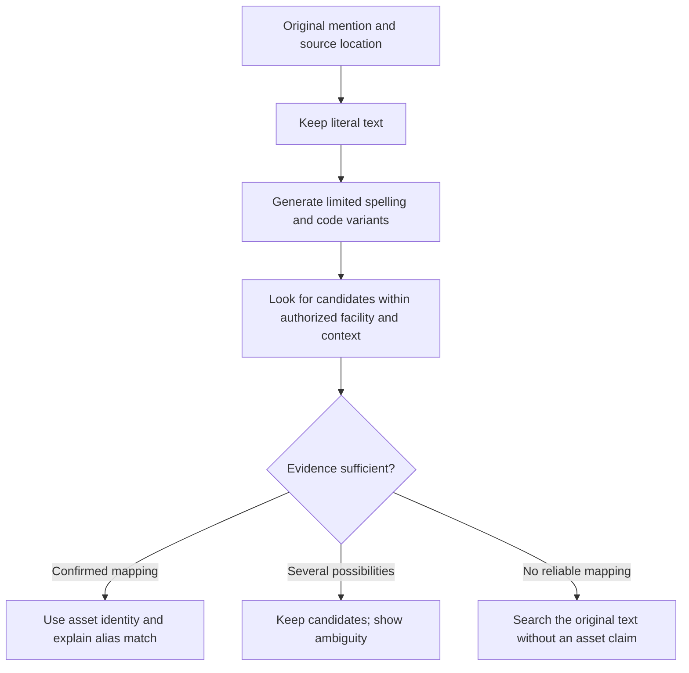

# Find the right asset despite different names

[Start here](README.md) · [Previous: resources](03-resources-and-metadata.md) · [Next: time and evidence](05-time-evidence-and-relationships.md)

**Proposal:** provide many routes to the same confirmed identity, while keeping uncertain matches visibly uncertain. Do not solve vocabulary variation by rewriting source records or equating every similar code.

**Book basis:** EPUB §28, “Naming Resources”; §§38–39, semantic and lexical relationships; §§47–48, category design. **Local basis:** [search direction, IF-AI-02 and IF-AI-05](/Users/maksimklimenko/dev/infl/ai-handoff/2026-10-14-chatgpt-memory-snapshot/intelliflow-memory-2026-10-14/04-ai-search-direction.md).

## There are several different problems

| Situation | Example | Suitable response |
| --- | --- | --- |
| Formatting variation | `MOT123321` / `MOT 123321` | Generate a conservative normalized search candidate |
| Mixed scripts / lookalikes | Latin `MOT` / Cyrillic `МОТ` | Compare in code-like tokens using controlled rules; retain original |
| Abbreviation | CIP / a local abbreviation | A domain- and language-scoped vocabulary entry |
| Typo | Siemens / Simens | Typo-tolerant text matching; protect exact code matching |
| Same asset, different legitimate label | Physical tag vs drawing reference | Confirmed alias relation with supporting context |
| Related assets | Pump and its motor | Typed relationship, not an alias |
| Same symptom, different words | “Trips after cleaning” / “stops after washdown” | Semantic retrieval, followed by evidence inspection |
| Same digits, different asset | Line 1 and Line 2 both mention `123321` | Keep distinct candidates until context resolves them |

The first six are not interchangeable. A single global “synonym” mechanism would conceal important differences.

## A conservative resolution process

In words: normalization produces candidates. Context and supporting evidence establish identity. A candidate that cannot be resolved can still be useful for ordinary text search.

Do not indiscriminately remove every separator, strip leading zeros, or transliterate all prose into one script. Those operations can destroy meaningful distinctions. Use bounded, versioned rules for known code patterns and test collisions.

## A small alias register

Start with the highest-value ambiguous or frequently searched equipment, not a plant-wide master-data project.

| Field | Example / purpose |
| --- | --- |
| Scope | Facility; location/line where needed |
| Target identity | Existing equipment key, or a separately verified component identity |
| Original alias | Literal spelling encountered in a source |
| Normalized candidate | Search form produced by a documented rule |
| Relationship | Same asset, part of, drives, previous label, or unresolved |
| Status | Candidate, confirmed, rejected |
| Evidence | Source record/field or approved asset reference |
| Validity | Applicable period, if known; otherwise unknown |
| Method/version | Deterministic rule, reviewer confirmation, or extraction version |

If component identities are not yet available in IntelliFlow, preserve unresolved mentions rather than manufacturing authoritative assets. The existing L3 equipment node can supply location context without claiming component-level precision.

## Separate concept vocabulary from asset aliases

A vocabulary describes concepts such as “pressure sensor.” An alias register identifies particular assets such as “the PT-12 fitted to this filler.” They answer different questions.

A minimal concept entry could have a stable concept key, preferred labels by language, alternative labels, a short scope note, and broader/narrower/related concepts. These distinctions are illustrated in the [W3C SKOS Primer](https://www.w3.org/TR/skos-primer/). IntelliFlow can borrow the conceptual model without implementing RDF or a semantic-web stack.

**IntelliFlow application:** keep `pump` and `motor` as separate concepts; “motor drives pump” expresses their relationship. A local abbreviation may expand differently by facility. A broader concept match should rank differently from an exact asset match.

The handoff identifies a brewery/Lean glossary in the translation prompt and an unused equipment taxonomy. Review them as seeds. An abbreviation's presence in a translation prompt is not validation for unrestricted query expansion.

## Multilingual retrieval needs its own tests

The handoff identifies Ukrainian/Russian, Georgian, Azerbaijani, English, and additional localization contexts. Do not equate supported UI language with proven search quality in that language.

A practical test matrix should include:

- Original-language queries against original-language records.
- A Ukrainian query finding relevant Russian text, and vice versa.
- Local-language text containing Latin manufacturer names and equipment codes.
- Latin-typed Cyrillic and mixed-script code variants.
- Georgian and Azerbaijani examples judged by speakers who understand the domain.
- Negation, uncertainty, abbreviations, and spelling variation in each pilot language.

Do not invent native-language “golden” judgments with a translation model and treat them as expert labels. Machine-generated examples can be smoke tests; they need human validation before becoming release evidence.

## Keep four controls conceptually independent

1. **Literal/exact matching:** preserve the requested identifier or phrase.
2. **Typo tolerance:** allow limited misspellings where appropriate.
3. **Transliteration/alias expansion:** offer alternate forms.
4. **Semantic retrieval:** find related meaning.

They need not all become visible switches, but they should be independently testable. The existing search handoff reports that disabling transliteration also disables some typo handling because of how variants are constructed. The new design should not preserve that accidental coupling.

For code-shaped queries, try exact literal and confirmed normalized matches first. Offer related candidates separately if ambiguity remains. Broad fuzzy matching on short numbers should not silently reinterpret an asset request.

## How the vocabulary stays manageable

Assign a vocabulary steward for the pilot—someone who understands that plant's language and equipment. Review a small queue of repeated failures and disputed aliases. Store why a candidate was accepted or rejected. Version changes and rerun collision tests before broad expansion.

Measure **correct links and false merges**, not just how many mentions the extractor finds. It is acceptable to leave an ambiguous mention unresolved. A wrong confident identity can contaminate every later summary, recommendation, and count.
