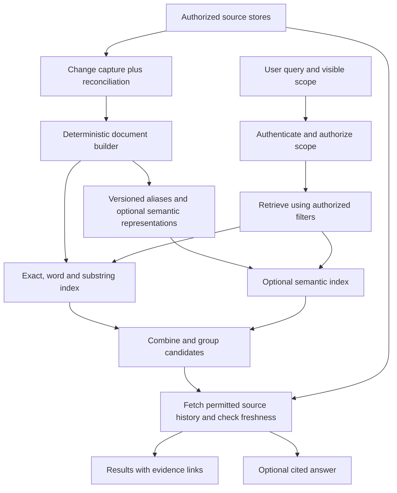

# A practical architecture for dependable Smart Search

[Start here](README.md) · [Previous: evidence](05-time-evidence-and-relationships.md) · [Next: evaluation](07-evaluation-and-acceptance.md)

**Recommendation:** modernize search as a sequence of independently testable capabilities. Keep the original stores authoritative; make every search representation rebuildable; add semantic retrieval only when the baseline is measurable.

**Status:** everything described as a target below is a proposal. The existing-system observations come from the dated [current search report](/Users/maksimklimenko/dev/infl/ai-handoff/07-SEARCH-CURRENT.md), [migration proposal](/Users/maksimklimenko/dev/infl/ai-handoff/08-SEARCH-EVOLUTION.md), [data model](/Users/maksimklimenko/dev/infl/ai-handoff/04-DATA-MODEL.md), and [security review](/Users/maksimklimenko/dev/infl/ai-handoff/10-SECURITY-AND-PERMISSIONS.md). No deployed state was checked here.

## What the handoff says already works

The main application and older `intelliflow-sp` client submit search requests through an RTDB queue. A worker queries Elasticsearch 5.4. Results contain keys, snippets, and card fields; opening a result reads the authoritative record.

That final separation is valuable: search finds candidates; the source supplies the record. Preserve it.

The handoff also reports incomplete historical coverage, missed metadata changes, a brittle error path, whole-word/phrase limitations, and parser omissions. The October export contains 441,547 top-level search documents, while a differently dated RTDB analysis reports missing historical `lastUpdated` values. These are **dated observations with different scopes**, not a current coverage denominator.

## Target shape

In words: prepare descriptions in the background, retrieve candidates within authorized scope, then fetch enough source history to present trustworthy results. Failure of the optional semantic or answer branch should leave ordinary search available where possible.

The diagram shows responsibilities, not a requirement for a separate service for every box.

## 1. Build reliable lexical retrieval first

Use explicit search fields for different matching needs:

- **Literal keyword/code:** asset references and tag numbers that need exact comparison.
- **Word-oriented text:** ordinary lexical ranking and phrase queries, using compatible analysis and stored positions.
- **Substring field:** preserve useful partial-word behavior without making every query depend only on n-grams.
- **Nested event text and metadata:** preserve author/date/text association within a matching event.
- **Structured filters:** facility, equipment/location, record type, dates, labels, and other validated values.

BM25 is a common way to rank word-based matches. It is not itself a guarantee of exact phrase semantics; phrase handling and analysis need separate design. Likewise, a lowercase code field is a deliberate normalization rule, not proof that two assets are identical.

Keep AND behavior for the familiar lexical mode. Define and test whether all terms must occur in one event, across fields of the parent, or anywhere in a thread. Do not silently loosen it during migration. A later semantic mode can find paraphrases without literal term overlap, but should be presented and evaluated as a distinct source of candidates.

## 2. Treat change capture as correctness work

The handoff's `lastUpdated` mechanism misses some writes. It also cannot, by itself, invalidate search content when an equipment name changes or a Firestore checklist changes.

**Proposed minimum responsibilities:**

1. Capture record changes, including administrative deletion or moves, even though ordinary app flows do not delete records.
2. Add separate change handling for any other indexed source: equipment, checklists, labels, alias dictionaries, and future documents.
3. Use a deterministic builder so the same source inputs and versions produce the same representation.
4. Retry failed indexing safely, retain failed work for inspection, and report lag.
5. Periodically reconcile source identities and content with indexed identities and content.

Firebase documents database write triggers, and recommends idempotent functions that behave safely when invoked more than once. Those capabilities support a queue-based design, but do not supply a complete search consistency protocol. [RTDB triggers](https://firebase.google.com/docs/functions/database-events) · [Firebase function guidance](https://firebase.google.com/docs/functions/tips).

### A timestamp alone is not an ordering protocol

The earlier migration sketch proposes timestamps or `lastUpdated` for external versioning. Refine that before implementation: an event arriving later may describe an older change; an unrelated edit may not update that field; two changes may share a timestamp.

A practical **protocol to design and test**, rather than copy verbatim:

- A source-change notification marks a record key dirty using an atomic per-key generation counter. This counter signals work; it is not the source's semantic revision.
- A worker claims a lease and generation, reads current authoritative inputs, builds the document, and writes with a monotonically ordered fencing token so an expired older worker cannot overwrite a newer result.
- Acknowledge only the generation successfully processed. If a newer generation exists, leave the key pending.
- A missing source becomes a versioned deletion/tombstone; retain sufficient fencing information to prevent stale work resurrecting it.
- Delayed duplicate notifications trigger a harmless reread of current state. Reconciliation repairs missed notifications and drift.

The exact transactions, fencing-token allocation, lease expiry, and engine behavior need a focused design and race-condition tests. Do not claim a simple “read, index, delete queue item” implementation is lossless.

A successful write during backfill can race with an older snapshot. Capture changes before or alongside backfill, use the same write-order protection, then reconcile before declaring the new index ready.

### Track dependencies and two kinds of change

Use a hash of all relevant search inputs, including text, structured metadata, and dependency versions, to identify search-document changes. Separately hash the exact embedding input plus model/configuration version to decide whether to recompute a vector.

A metadata change can require a filter update without new embeddings. An equipment rename may require updating many descriptions. A permissions change requires immediate authorization correctness even if search content has not changed. Do not make access revocation wait for a vector refresh.

Reconciliation cannot compare content hashes by reading only source keys. Key scans detect missing/ghost documents; stale-content detection requires relevant source content or trusted revisions/hashes. Budget and measure those reads.

## 3. Add hybrid retrieval as an experiment

**Hybrid retrieval** combines complementary candidate lists, such as lexical matches and semantic matches. Begin with a controlled candidate budget for each, group duplicate projections, and evaluate the result.

Reciprocal rank fusion (RRF) combines list positions rather than directly adding incompatible lexical and vector scores. It is a reasonable baseline, not a guaranteed winner or a confidence measure. Compare it with a tuned alternative on IntelliFlow's queries. [OpenSearch RRF documentation](https://docs.opensearch.org/latest/vector-search/ai-search/hybrid-search/rrf/) · [OpenSearch engineering article](https://opensearch.org/blog/introducing-reciprocal-rank-fusion-hybrid-search/).

**IntelliFlow-specific proposal:** exact code requests retain a clearly identified exact-results route; uncertain broader candidates appear separately. For natural-language questions, combine candidate lists, then expand selected incident histories for evidence. Apply all mandatory scope and access constraints to every branch, including any lexical fallback, reranker input, suggestions, and counts.

A reranker is an optional second-stage model that compares the query to a limited candidate set. Add one only when its quality gain justifies latency and cost. It cannot rescue a relevant incident never retrieved in the first place.

## 4. Preserve context when introducing passages

A standalone sentence such as “checked; no fault found” is difficult to retrieve and interpret. Preserve its parent issue, equipment, event type, date, and neighboring evidence.

Anthropic's contextual-retrieval article explores adding explanatory context before indexing passages. Its reported improvements come from its experiments, not IntelliFlow. [Contextual Retrieval](https://www.anthropic.com/engineering/contextual-retrieval).

**Our proposal:** first attach deterministic context already known from the source, such as the parent title and equipment path. Consider generated context only if it improves the evaluation set, preserve it separately, and ensure it does not insert a later diagnosis into an earlier event. Short work records often need no arbitrary chunking at all.

## 5. Keep authority outside the model

Authenticate the user and compute permitted scope on the server. A selected facility key is a request, not authorization. The Admin SDK bypasses Firebase rules, so a new backend must perform its own access checks. Per-facility indices help operational separation but do not replace authorization.

Apply permissions before candidate retrieval and again when fetching source evidence. Validate the current policy and membership rules rather than implementing only one membership path from a simplified diagram. Include caches, related links, facet counts, autocomplete, and answer storage in permission tests.

Retrieved text is data, even if it contains instructions to the assistant. The initial assistant should use bounded read tools and validated query parameters. It should not generate arbitrary database paths, execute source-text commands, or write operational changes.

The handoff identifies source-level access-control risks with deployed status unknown. Resolve their current status before a live pilot. External model use also needs an agreed customer data policy; deleting author fields alone does not remove personal information embedded in narrative text.

## 6. Choose an engine with a bounded comparison

| Candidate | Why investigate | What must be measured |
| --- | --- | --- |
| OpenSearch | Closest architectural continuity with existing search; explicit fields, nested events, and hybrid options | Query compatibility, multilingual analysis, relevant results, resource use, operational burden |
| Existing PostgreSQL option | May reuse infrastructure and operational knowledge | Available extensions/version, short infix queries, event joins, ranking, highlighting, interference with current workloads |

PostgreSQL's `pg_trgm` supports trigram similarity and indexed pattern matching; full-text retrieval and vector retrieval are separate design elements. Availability and performance on the existing managed instance have not been verified. [Official `pg_trgm` documentation](https://www.postgresql.org/docs/18/pgtrgm.html).

The old handoff's engine version numbers, hosting suggestions, and memory estimates are dated proposals. Select a supported version and check provider capabilities when implementing. Do not treat an illustrative 4 GiB server as a measured capacity plan. Compare total maintenance effort, backup/rebuild needs, indexing latency, and query quality—not only hosting price.

## 7. Preserve a reversible rollout

Run the new indexer separately; use a separate shadow request path. Never put two deleting consumers on the current production request queue. Compare behavior, then enable a small pilot behind a flag.

The `intelliflow-sp` adapter needs explicit contract tests: numeric `hits.total`, expected hit/card fields, a highlight object even when empty, paging bounds, and readable errors with the expected user ownership. Escape source text before adding highlight markup and keep rendering safe.

Keep the old route usable through a defined observation period, with fresh enough data for meaningful rollback. Backups, index snapshots, and rebuild procedures solve different problems; retaining an old export alone is not a rollback plan.
